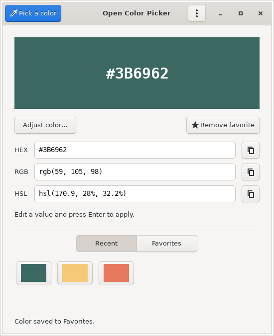

<p align="center">
  
</p>

<h1 align="center">Open Color Picker</h1>

<p align="center">
  <a href="https://github.com/fossgap/open-color-picker/actions/workflows/test-ci.yml"></a>
  <a href="https://github.com/fossgap/open-color-picker/actions/workflows/release-ci.yml"></a>
  <a href="https://github.com/fossgap/open-color-picker/releases"></a>
  <a href="https://github.com/fossgap/open-color-picker/releases/latest"></a>
  <a href="LICENSE"></a>
  <a href="https://github.com/fossgap/open-color-picker/releases/latest"></a>
</p>

> Pick a color from your Linux desktop, copy its value, and save your favorites. Built with Rust and GTK, part of [Fossgap](https://github.com/fossgap).

[Features](#features) · [Install](#install) · [Use](#use) · [Building from source](#building-from-source)

<p align="center">
  
</p>

## Features

- Full-screen desktop picking with a magnifier and keyboard controls
- Copy or edit HEX, RGB, and HSL values
- Favorites and recent colors kept between sessions
- Configurable shortcuts and a system tray menu
- Light and dark desktop themes
- English, French, Spanish, German, Portuguese, Simplified Chinese, and Japanese interface; other languages fall back to English

## Install

Download the **Linux x86_64** package for your distribution from
[Releases](https://github.com/fossgap/open-color-picker/releases/latest).
Open a terminal in the folder containing the download, then run the matching
commands below. These examples use **v0.1.3**; adjust the filename if needed.

**Debian 12+ / Ubuntu 24.04+ / Kali — `.deb`**

```sh
sudo apt install ./open-color-picker_0.1.3_amd64.deb
```

**Fedora — `.rpm`**

```sh
sudo dnf install ./open-color-picker-0.1.3-1.x86_64.rpm
```

**Arch Linux — `.pkg.tar.zst`**

```sh
sudo pacman -U ./open-color-picker-0.1.3-1-x86_64.pkg.tar.zst
```

After installing a native package, launch **Open Color Picker** from your
applications menu or run `open-color-picker` in a terminal.

**AppImage — portable, no installation needed**

```sh
chmod +x ./OpenColorPicker-0.1.3-x86_64.AppImage
./OpenColorPicker-0.1.3-x86_64.AppImage
```

AppImage requires glibc 2.36 or newer, as provided by Debian 12+ and Ubuntu
24.04+. If launch fails with a FUSE error, use:

```sh
APPIMAGE_EXTRACT_AND_RUN=1 ./OpenColorPicker-0.1.3-x86_64.AppImage
```

Screen capture needs your desktop’s capture portal on Wayland. Tray support
needs an AppIndicator-compatible tray; GNOME may need an extension.
See [package details](docs/packaging.md) if needed.

## Use

1. Choose **Pick a color** and allow screen capture if prompted.
2. Point at a pixel using the magnifier; use the
   arrow keys for precise adjustments. Click or press **Enter** to select and
   copy HEX. **Escape** cancels.
3. Copy another format, edit a value, or choose **Save color**.

The desktop stays live when supported. Otherwise, picking uses a frozen
desktop overlay with the same magnifier and controls. Wayland uses the frozen overlay.

Press **F1** to customize keyboard shortcuts. For a desktop-wide shortcut,
bind `open-color-picker --pick` in your desktop’s keyboard settings. The tray
menu offers **Pick a color**, **Show colors**, and **Quit**; closing the window
keeps the app in the tray when one is available. Hidden windows stay hidden across
screen lock and unlock. If the tray disappears, the app allows three seconds for
reconnection after unlocking before reopening the window.

## Building from source

Install Rust, then the build dependencies. On Debian, Ubuntu, or Kali:

```sh
sudo apt install build-essential pkg-config libgtk-3-dev librsvg2-common \
  libgstreamer1.0-dev libgstreamer-plugins-base1.0-dev \
  gstreamer1.0-plugins-base gstreamer1.0-pipewire
cargo run --locked
```

See [development](docs/development.md), [translations](docs/translations.md),
[packaging](docs/packaging.md), and [CI and releases](docs/ci-release.md).

Report bugs or suggest improvements in
[Issues](https://github.com/fossgap/open-color-picker/issues).

## License

Licensed under [GNU GPL v3.0 only](LICENSE) (`GPL-3.0-only`). Dependencies retain their own licenses.
